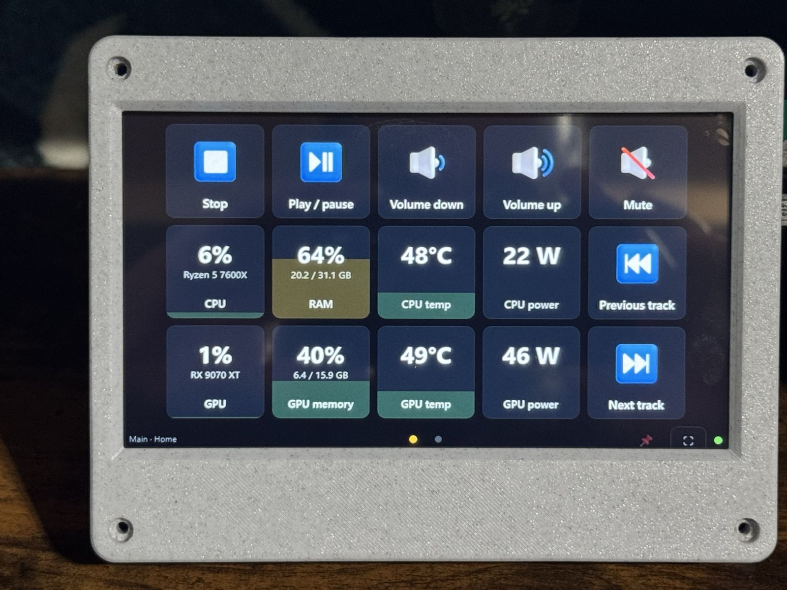

# TapDeck

TapDeck turns a small touch screen next to your keyboard into a deck of buttons for your Windows PC. Tap a key to press a shortcut, launch an app, control music and volume, mute Discord or your mic, or run OBS. Keys can also show live CPU, GPU, temperature and memory stats.

## Download

TapDeck is coming to the Microsoft Store. This page will link to it once it's live.

Needs Windows 10 or 11 and any touch screen that Windows sees as a monitor.

## Build your own deck

The deck in the photo is made from:

| Part | What was used |
|---|---|
| Touch screen | [XIITIA 7 inch IPS touch screen, 1024x600, HDMI, capacitive](https://link.amazon/B08oKAUpY)* |
| Case | [7" Touch Display Case by armourcraft](https://www.thingiverse.com/thing:4750258) on Thingiverse |

\* Affiliate link: as an Amazon Associate I earn from qualifying purchases.

1. Print the case and fit the screen into it. The case was designed for a Raspberry Pi screen of this size, but TapDeck needs no Pi: the screen plugs straight into your PC.
2. Connect the screen's HDMI cable to your PC, and its USB cable for touch.
3. Install TapDeck from the Microsoft Store. It opens the deck on the smallest screen that isn't your main one. To pick a different screen, go to **Settings > Deck screen**.

The case's feet flip to stand the screen at 15° or 30°. See the Thingiverse page for its print settings, hardware and license.

## Privacy

TapDeck runs entirely on your PC, with no account, ads or tracking. See the [privacy policy](https://callouscarl.github.io/tapdeck-releases/privacy.html).

## Help

Found a problem or have an idea? [Open an issue](https://github.com/CallousCarl/tapdeck-releases/issues).
